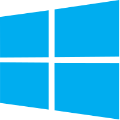

# macintosh.js

This is Mac OS 8, running in an [Electron](https://electronjs.org/) app pretending to be a 1991 Macintosh Quadra. Yes, it's the full thing. I'm sorry.


## Downloads

<table class="is-fullwidth">
</thead>
<tbody>
</tbody>
  <tr>
    <td>
      <br />
      Windows
    </td>
    <td>
      <span>32-bit</span>
      <a href="https://github.com/felixrieseberg/macintosh.js/releases/download/v1.2.0/macintoshjs-1.2.0-setup-ia32.exe">
        💿 Installer
      </a> |
      <a href="https://github.com/felixrieseberg/macintosh.js/releases/download/v1.2.0/macintosh.js-win32-ia32-1.2.0.zip">
        📦 Standalone Zip
      </a>
      <br />
      <span>64-bit</span>
      <a href="https://github.com/felixrieseberg/macintosh.js/releases/download/v1.2.0/macintoshjs-1.2.0-setup-x64.exe">
        💿 Installer
      </a> |
      <a href="https://github.com/felixrieseberg/macintosh.js/releases/download/v1.2.0/macintosh.js-win32-x64-1.2.0.zip">
        📦 Standalone Zip
      </a><br />
      <span>
        ❓ Don't know what kind of chip you have? Hit start, enter "processor" for info.
      </span>
    </td>
  </tr>
  <tr>
    <td>
      <br />
      macOS
    </td>
    <td>
      <span>Intel Processor</span>
      <a href="https://github.com/felixrieseberg/macintosh.js/releases/download/v1.1.0/macintosh.js-darwin-x64-1.1.0.zip">
        📦 Standalone Zip
      </a><br />
      <span>Apple M1 Processor</span>
      <a href="https://github.com/felixrieseberg/macintosh.js/releases/download/v1.1.0/macintosh.js-darwin-arm64-1.1.0.zip">
        📦 Standalone Zip
      </a><br />
      <span>
        ❓ Don't know what kind of chip you have? Learn more at <a href="https://support.apple.com/en-us/HT211814">apple.com</a>.
      </span>
    </td>
  </tr>
  <tr>
    <td>
      <br />
      Linux
    </td>
    <td>
      <span>32-bit</span>
      <a href="https://github.com/felixrieseberg/macintosh.js/releases/download/v1.1.0/macintosh.js-1.1.0-1.i386.rpm">
        💿 rpm
      </a> |
      <a href="https://github.com/felixrieseberg/macintosh.js/releases/download/v1.1.0/macintosh.js_1.1.0_i386.deb">
        💿 deb
      </a><br />
      <span>64-bit</span>
      <a href="https://github.com/felixrieseberg/macintosh.js/releases/download/v1.1.0/macintosh.js-1.1.0-1.x86_64.rpm">
        💿 rpm
      </a> |
      <a href="https://github.com/felixrieseberg/macintosh.js/releases/download/v1.1.0/macintosh.js_1.1.0_amd64.deb">
        💿 deb
      </a><br />
      <span>ARM64</span>
      <a href="https://github.com/felixrieseberg/macintosh.js/releases/download/v1.1.0/macintosh.js-1.1.0-1.arm64.rpm">
        💿 rpm
      </a> |
      <a href="https://github.com/felixrieseberg/macintosh.js/releases/download/v1.1.0/macintosh.js_1.1.0_arm64.deb">
        💿 deb
      </a><br />
      <span>ARMv7 (armhf)</span>
      <a href="https://github.com/felixrieseberg/macintosh.js/releases/download/v1.1.0/macintosh.js-1.1.0-1.armv7hl.rpm">
        💿 rpm
      </a> |
      <a href="https://github.com/felixrieseberg/macintosh.js/releases/download/v1.1.0/macintosh.js_1.1.0_armhf.deb">
        💿 deb
      </a><br />
      <span>
        ❓ Don't know what kind of chip you have? Run `uname -m` in the console.
      </span>
    </td>
  </tr>
</table>

<hr />


## Install using Homebrew
```
brew install --cask macintoshjs
```

## Does it work?
Yes! Quite well, actually - on macOS, Windows, and Linux. Bear in mind that this is written entirely in JavaScript, so please adjust your expectations. The virtual machine is emulating a 1991 Macintosh Quadra 900 with a Motorola CPU, which Apple used before switching to the PowerPC architecture (Apple/IBM/Motorola) in the mid 1990s.

## Should this have been a native app?
Absolutely.

## Does it run my favorite game or app?
The short answer is "Yes". In fact, you'll find various games and demos preinstalled, thanks to an old MacWorld Demo CD from 1997. Namely, Oregon Trail, Duke Nukem 3D, Civilization II, Alley 19 Bowling, Damage Incorporated, and Dungeons & Dragons.

There are also various apps and trials preinstalled, including Photoshop 3, Premiere 4, Illustrator 5.5, StuffIt Expander, the Apple Web Page Construction Kit, and more.

## Can I transfer files from and to the machine?

Yes, you can. Click on the "Help" button at the bottom of the running app to see instructions. You can transfer files directly - or mount disk images.

## Can I connect to the Internet?

Partially. The emulator now exposes a virtual Ethernet card (thanks to [Infinite Mac](https://infinitemac.org)'s `ether js` driver). Out of the box, frames are bridged to UDP port 6066 — the same "udptunnel" scheme native Basilisk II / SheepShaver use — so two copies of macintosh.js on the same LAN can talk AppleTalk to each other, share files via the Chooser, and so on.

Reaching the modern Internet additionally needs a userspace TCP/IP NAT (a `slirp`-style gateway) plugged into `src/main/ethernet.ts`. That isn't bundled yet; even with it, the 1997-era browsers on the disk image won't get far against today's TLS. Internet Explorer, Netscape, and the "Web Sharing Server" are still installed if you want to play around.

## Should I use this for [serious application]?

Probably not. This is a toy - it's not the best nor the most performant way to emulate an old Macintosh. It is, however, a quick and easy way to experience a bit of nostalgia if you're _not_ trying to do anything serious with it.

## Credits

Please check out the [CREDITS](CREDITS.md)! This app wouldn't be possible without the hard work of [Christian Bauer](https://www.cebix.net/) and [James Friend](https://jamesfriend.com.au/), who did everything that seems like computing magic here.

## License

This project is provided for educational purposes only. It is not affiliated with and has
not been approved by Apple.
